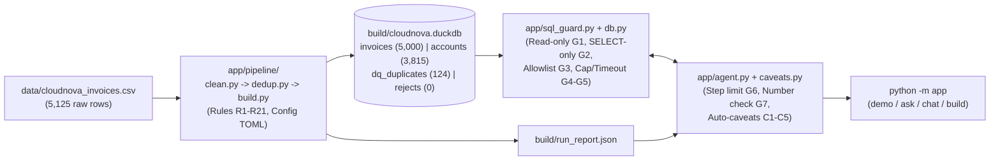

# CloudNova — Spec-Driven Invoice Pipeline & Guarded Query Agent (Track B)

A spec-first data cleaning pipeline (`CSV -> DuckDB`) and guarded natural-language-to-SQL query tool built for CloudNova's finance team. Every number is traceable to a numbered rule in [`specs/`](./specs/), backed by an independent reference verifier and a 40-case evaluation suite.

---

## 1. Quick Start (Single Command)

**Prerequisites:** Python 3.11+ (`duckdb`, `anthropic`, `python-dotenv`).

```bash
# 1. Create virtualenv and install dependencies (if not already present)
python3 -m venv .venv
.venv/bin/pip install -r requirements.txt

# 2. Run the demo (builds build/cloudnova.duckdb if missing, then answers Q1-Q6)
#    Without ANTHROPIC_API_KEY in .env, automatically runs in --offline reference mode.
.venv/bin/python -m app

# 3. Run the offline evaluation suite (31 offline cases: 29 PASS, 2 expected XFAIL)
.venv/bin/python -m evals
```

### All CLI Commands

```bash
.venv/bin/python -m app                        # Demo: answers the 6 stakeholder questions
.venv/bin/python -m app --offline              # Demo using reference SQL (no API key needed)
.venv/bin/python -m app build                  # Rebuild build/cloudnova.duckdb & print run report
.venv/bin/python -m app ask "How much have we given back in refunds?"   # Single NL question (needs key)
.venv/bin/python -m app chat                   # Interactive REPL (needs key)
.venv/bin/python -m evals                      # Offline eval suite (no API key needed)
.venv/bin/python -m evals --live               # Offline + 9 live LLM NL-to-SQL cases (needs key)
```

To enable live natural-language queries with Claude, copy `.env.example` to `.env` and set `ANTHROPIC_API_KEY=sk-ant-...`.

---

## 2. Stakeholder Answers (from `python -m app`)

| # | Stakeholder Question | Answer | Key Caveats Attached |
|---|----------------------|--------|----------------------|
| **Q1** | **2024 Recognized Revenue (`paid`)** | **$32,655,352.52** across **888** paid invoices. Net of the 70 refunds dated 2024 (-$1,931,282.82): **$30,724,069.70**. | `C1` (FX direction), `C5` (16 status conflicts) |
| **Q2** | **Highest Avg MRR per Active Account by Region** | **APAC leads at $6,147.30** (753 active accounts), followed by NA ($5,632.84, 739), EMEA ($5,327.66, 781), LATAM ($5,187.55, 789). | `C2` (`account_id` collisions), `C4` (future dates) |
| **Q3** | **Total Refunds Given Back** | **$8,925,163.84** across **292** refunded invoices (54 in 2023, 70 in 2024, 96 in 2025, 67 in 2026, 5 in 2027). | `C1` (FX), `C4` (future dates), `C5` (status conflicts) |
| **Q4** | **Churn Rate: Enterprise vs Starter** | **Enterprise: 21.92%** (171 / 780 accounts) vs **Starter: 18.81%** (354 / 1,882). Pro is **19.77%** (228 / 1,153). | `C2` (`account_id` collisions), `C4` |
| **Q5** | **Top 5 Accounts by Net Revenue & CSAT <= 2 Flag** | 1. `ACC-7509` ($1,210,592.75, CSAT 4)<br/>2. `ACC-1420` ($1,208,092.75, CSAT 5)<br/>3. `ACC-9946` ($1,205,642.75, CSAT 4)<br/>4. `ACC-1196` ($1,107,352.84, CSAT 3)<br/>5. `ACC-5211` ($1,085,078.48, CSAT 5)<br/>**None has CSAT <= 2.** (3 of 5 have mixed company names). | `C1` (FX flips all 5), `C2` (`account_id` collisions), `C4` |
| **Q6** | **Invoices Stuck in `pending`/`failed` & Exposed $** | **903 invoices** totaling **$29,141,315.77** exposed: **505 `pending`** ($15,934,168.41) and **398 `failed`** ($13,207,147.36). | `C1`, `C4` (23 future-dated stuck invoices), `C5` |

---

## 3. Specifications & Architecture

All specifications live in [`/specs`](./specs/) and were authored **before** the pipeline and agent implementation:

- **[`specs/README.md`](./specs/README.md)** — Decision log (`D1–D10`) with quantitative evidence from the raw file and sensitivity analysis showing how alternative choices move each metric.
- **[`specs/01_data_contract.md`](./specs/01_data_contract.md)** — Target DuckDB schema (`invoices`, `invoice_contacts`, `accounts`, `dq_duplicates`, `rejects`), cleaning rules `R1–R21`, and database invariants `I1–I5`.
- **[`specs/02_metrics.md`](./specs/02_metrics.md)** — Canonical SQL for `Q1–Q6`, deterministic caveat attachment rules `C1–C5`, and sensitivity table.
- **[`specs/03_query_interface.md`](./specs/03_query_interface.md)** — CLI contract, tool loop (`run_sql`, `cannot_answer`), and security/accuracy guardrails `G1–G8`.
- **[`specs/04_evals.md`](./specs/04_evals.md)** — Full test matrix (`P1–P13`, `M1–M6`, `G1–G6`, `A1–A4`, `X1–X2`, `N1–N9`).
- **[`docs/architecture.md`](./docs/architecture.md)** — Mermaid architecture diagram and data-flow walkthrough.
- **[`CLAUDE.md`](./CLAUDE.md)**, **[`.claude/settings.json`](./.claude/settings.json)**, and **[`docs/SESSION_LOG.md`](./docs/SESSION_LOG.md)** — AI steering rules, tool permission boundaries, and session log.



---

## 4. Key Design Decisions, Data Landmines & Trade-Offs

Profiling `data/cloudnova_invoices.csv` (5,125 rows) surfaced several non-obvious traps beyond those listed in `BUSINESS_CONTEXT.md`:

1. **The `NA` North America Trap (`R1`):**
   - `region = 'NA'` appears on 1,245 invoices. Default CSV readers (like `pandas.read_csv`) parse `"NA"` as `NaN`/`NULL`, silently erasing North America. We read the CSV with Python's standard `csv` module as raw strings (`no pandas`) and enforce `NOT NULL CHECK (region IN ('NA', 'EMEA', 'APAC', 'LATAM'))`.
2. **Duplicate Status Conflicts (`R16`, `D3`):**
   - 124 `invoice_id`s appear twice (81 exact copies, 27 spelling variants like `Complete` vs `PAID`, and **16 status conflicts** where one copy says `paid` and the other says `pending`, `void`, `failed`, or `refunded`). Because the export has no `updated_at` timestamp and row order is shuffled, we resolve conflicts conservatively (`refunded > void > failed > pending > paid`) so revenue is never overstated, and flag `dq_status_conflict = true`.
3. **Date Format Disambiguation (`R11`, `D4`):**
   - Testing every date with day $> 12$ proved that `1,532 / 1,532` slash dates (`NN/NN/YYYY`) are `MM/DD/YYYY` and `313 / 313` dash dates (`NN-NN-YYYY`) are `DD-MM-YYYY`. We apply that rule deterministically and flag the 565 invoice dates where both parts are $\le 12$ (`dq_invoice_date_ambiguous`).
4. **PII Isolation & Multi-Layer Guardrails (`G1–G8`):**
   - Billing emails (`contact_email`, including 139 repaired `_at_` addresses) are split into `invoice_contacts` (`R9`). The query agent connects to DuckDB in `read_only=True` mode with `enable_external_access = false` and `lock_configuration = true` (`G1`), and `sql_guard.py` (`G2, G3`) blocks any query touching `invoice_contacts`, `rejects`, system catalogs, or external files.
   - The application—never the LLM—attaches data-quality caveats `C1–C5` by inspecting the SQL that actually executed, and `G7` verifies that every 4+ digit number in the LLM's text response exists in the SQL result table.

---

## 5. Known Limitations & Failure Modes (Honesty About Limits)

We baked the two biggest data limitations directly into the evaluation suite as **`XFAIL` (expected failure) cases `X1` and `X2`** so they remain visible on every run:

1. **FX Conversion Direction on `EUR` and `GBP` Invoices (`D1`, Case `X1`):**
   - In the raw file, every `EUR` and `GBP` invoice has `amount_local = usd_price_formula * fx_rate` (e.g., a $49,000 USD annual Starter invoice is stored as `52,920.00 EUR`). When we multiply by the briefing's rates (`EUR->USD 1.08`, `GBP->USD 1.27`), EUR invoices convert to $1.08^2 = 1.1664\times$ list price and GBP to $1.27^2 = 1.6129\times$ list price.
   - Under `fx_mode = "multiply"` (default), 2024 paid revenue is **$32,655,352.52**. Under `fx_mode = "divide"`, it is **$29,565,429.38**—and **the Top 5 accounts (`Q5`) share 0 of 5 accounts** between the two modes (`X1`). Caveat `C1` warns finance on every USD query.
2. **`account_id` Groups Unrelated Company Names (`D2`, Caveat `C2`):**
   - Out of 980 `account_id`s with 2+ invoices, **976 have multiple company names** across their invoices (synthetic data artifact where `account_id` and `account_name` were generated independently). Grouping by `account_id` follows the schema, sets `dq_identity_conflict = true`, and attaches Caveat `C2` on every account-level query.
3. **121 Invoices with Truncated/Rounded Cents (`D6`, Case `X2`):**
   - 121 raw rows are stored as whole integers (e.g. `31432` GBP on `INV-101502`) where the price formula has fractional cents (`31432.50`), totaling `38.55` currency units of discrepancy. Rather than inventing ledger amounts from the price list, the pipeline keeps the ledger amount and sets `dq_missing_cents = true` (`X2`).
4. **107 Future-Dated Invoices (`D5`, Caveat `C4`):**
   - 107 invoices have `invoice_date` after `2026-11-12` (up to `2027-07-23`), including 23 `pending`/`failed` invoices ($313,343.97 of `Q6` exposure). They are flagged with `dq_future_dated = true` and noted via Caveat `C4`.
5. **Natural-Language-to-SQL Ambiguity:**
   - Open-ended questions like *"What was our revenue in 2024?"* can mean gross `paid` revenue ($32.66M) or net of `refunded` rows ($30.72M). Our Q1 metric and prompt instructions return **both** side by side so a stakeholder never gets one without seeing the other.

---

## 6. Production Hardening Included

1. **GitHub Actions CI (`.github/workflows/evals.yml`)**: Runs the full offline build and evaluation suite (`python -m evals`) on every push and pull request.
2. **Defense-in-Depth SQL Guardrails (`app/db.py`, `app/sql_guard.py`)**: Combines DuckDB engine-level lockdown (`read_only=True`, `enable_external_access = false`, `lock_configuration = true`), AST/token-level single-statement `SELECT`/`WITH` validation, table allowlisting (blocking PII in `invoice_contacts`), `EXPLAIN` pre-flight check, 200-row result cap, and a 10-second interrupt timer.
3. **Audit Logging (`build/query_log.jsonl` & `build/run_report.json`)**: Every pipeline build emits a machine-readable DQ report, and every question logs its SQL, status, caveats, latency, and token usage without leaking row data.

---

## 7. What We Would Do With Another Day

- **Resolve `D1` and `D2` with Finance & Upstream Engineering:** Confirm whether the billing export multiplied USD amounts by FX instead of dividing, and pull the upstream CRM mapping table to fix the `account_id <-> account_name` join before reporting account-level LTV.
- **Link Refunds to Original Invoices:** Add `parent_invoice_id` from the billing system so refunds can be netted against the cohort of the original sale as well as by refund date.
- **Semantic Caching & Cost Tracking:** Cache normalized questions/SQL templates and surface token cost in `query_log.jsonl`.
- **dbt / Incremental Snapshots:** Move the SQL rollups into incremental snapshots keyed by export timestamp so finance can track status transitions (`pending -> paid` vs `pending -> failed`) over time.
