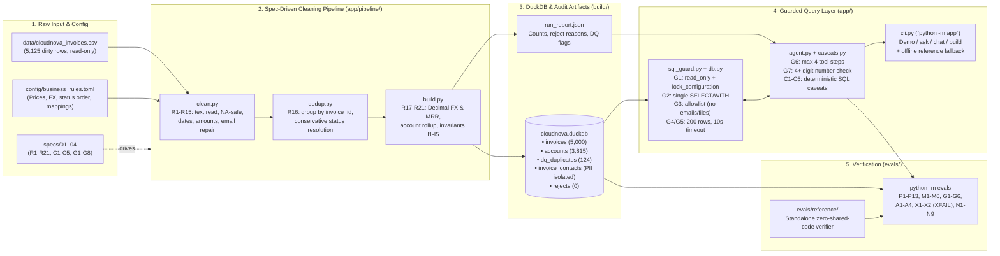

# System Architecture (`docs/architecture.md`)

## Data Flow Summary

1. **Ingest & Clean (`app/pipeline/clean.py`)**: Reads `data/cloudnova_invoices.csv` strictly as text (`R1`, preventing `NA` North America rows from becoming `NULL`). Normalizes plans, billing cycles, statuses, payment methods, dates (`slash = MM/DD/YYYY`, `dash = DD-MM-YYYY`), and currencies (`R2–R15`). Strips PII emails into a separate structure (`R9`). Uncleanable rows are routed to `rejects` with a rule code (`D10`), never silently dropped.
2. **Deduplicate (`app/pipeline/dedup.py`)**: Groups by `invoice_id` (`R16`). Exact copies (81 invoice IDs) and same-meaning variants (27 invoice IDs) collapse cleanly. The 16 invoice IDs with conflicting statuses resolve via conservative precedence (`refunded > void > failed > pending > paid`, `D3`) and set `dq_status_conflict = true`.
3. **Derive & Load (`app/pipeline/build.py`)**: Applies `Decimal` FX conversion (`R17`) and formula-based MRR (`R18`), builds the `accounts` rollup table (`R19`), verifies database invariants `I1–I5`, and writes `build/cloudnova.duckdb` and `build/run_report.json` (`R21`).
4. **Guarded Query Agent (`app/db.py`, `app/sql_guard.py`, `app/agent.py`, `app/caveats.py`)**: Opens DuckDB in `read_only=True` mode with `enable_external_access = false` and `lock_configuration = true` (`G1`). Validates every SQL query against `G2–G5` (single `SELECT`/`WITH`, allowlisted tables `invoices`, `accounts`, `dq_duplicates` only—blocking `invoice_contacts` PII and `rejects`). Deterministically attaches data-quality caveats `C1–C5` by inspecting the executed SQL and checks `G7` so every 4+ digit number in the prose answer matches the SQL result table.
